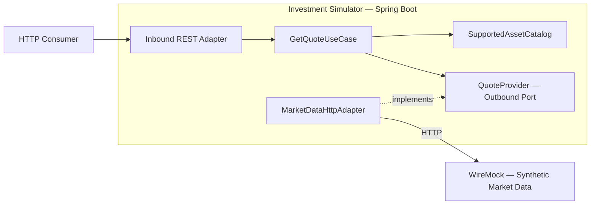

# Engineering Lab

**A hands-on software engineering lab focused on architectural decisions, modern Java, distributed systems, resilience, observability, and reproducible experiments.**

Engineering Lab uses a **fictional investment simulator** as a small, realistic domain for exploring software engineering challenges. Its purpose is not to build a brokerage platform or a production trading system. The goal is to understand problems, compare trade-offs, implement deliberately, and validate behavior with evidence.

> **Project status:** The domain, quote use case, outbound HTTP adapter, and public REST API are implemented. All 103 tests pass, covering the seven UC-001 acceptance criteria and the defined adverse scenarios through isolated HTTP tests with WireMock. Maven `verify` builds the executable JAR and generates the JaCoCo report. See the [test coverage and results](docs/testing/uc-001-tests.md) (Brazilian Portuguese).

## Goals

This repository is a place to practice skills that are difficult to demonstrate through isolated tutorials:

- Turn business requirements into explicit domain models, API contracts, and testable behavior.
- Make architectural decisions based on constraints and trade-offs rather than trends.
- Explore modern Java, Spring Boot, Hexagonal Architecture, and pragmatic Domain-Driven Design (DDD).
- Investigate integration failures, timeouts, concurrency, resilience, and observability as the system evolves.
- Run reproducible experiments, report measurements, and distinguish findings from assumptions.
- Use AI tools to accelerate engineering work **without delegating technical ownership**.

**The main outcome is learning.** The code, tests, Architecture Decision Records (ADRs), and experiment reports are evidence of that process.

## Initial scope

The first increment focuses on on-demand retrieval of synthetic stock reference prices from a simulated market-data provider. Quotes are informational only; the simulator does not execute real trades or connect to brokers or B3.

Business rules, alternative flows, failure scenarios, and acceptance criteria are maintained in [UC-001 — Consultar cotação](docs/use-cases/uc-001-consultar-cotacao.md) (Brazilian Portuguese).

**Out of scope for this increment:** trading, portfolios, quote history, authentication, frontend, persistent storage, additional assets, and real prices. Future technical experiments do not automatically expand the business scope.

## Technical direction

| Area | Initial choice |
| --- | --- |
| Language | **Java 25 (LTS)** |
| Framework | **Spring Boot 4.1.1**, Spring MVC |
| Build | Maven |
| Repository | Monorepo; initially **one Spring Boot application** |
| Architecture | **Hexagonal Architecture (Ports & Adapters)** |
| Code organization | **Package by Feature**, starting with `quote` |
| Domain modeling | Pragmatic **DDD**: ubiquitous language, Value Objects, invariants, domain policies |
| HTTP client | Spring `RestClient` |
| Simulated provider | WireMock 3.13.2 in Docker for local development |
| Testing | JUnit Jupiter, Mockito when useful, WireMock, Spring integration tests |
| Code quality | JaCoCo first; SonarQube and CI in later increments |

New technologies are introduced only when they address an actual requirement or a technical hypothesis. A monorepo does not imply multiple running services, and Hexagonal Architecture does not require an elaborate module hierarchy.

### Architecture overview



The diagram illustrates the **runtime interaction**, not the direction of source-code dependencies. The application depends on an internal port; the HTTP adapter implements it.

- **Domain:** pure Java concepts and invariants, independent of Spring and transport protocols.
- **Application:** use-case orchestration and ports expressing external needs.
- **Inbound adapters:** translate public HTTP requests and responses.
- **Outbound adapters:** call external systems and translate provider-specific contracts into internal concepts.

The **Anti-Corruption Layer (ACL)** is a responsibility of the outbound integration boundary. It does not require an additional service or layer by default.

### Initial domain model

```text
Quote (Value Object)
├── Ticker (Value Object)
├── Money (Value Object: amount + currency)
└── referenceTime

SupportedAssetCatalog (domain policy)
```

`Money` can represent negative, zero, or positive amounts. `Quote` enforces the quote-specific invariants: **positive reference price and BRL currency** for UC-001. The simulator—not the provider—defines which assets are supported.

DDD patterns are applied where they explain business concepts. Entities, aggregates, repositories, and domain services will not be invented merely to showcase patterns.

## Repository layout

The structure below includes the current application, documentation, and local WireMock configuration. New directories will be created only when needed.

```text
engineering-lab/
├── README.md
├── AGENTS.md
├── LICENSE
├── docs/
│   ├── use-cases/
│   │   └── uc-001-consultar-cotacao.md
│   ├── architecture/
│   │   ├── initial-architecture.md
│   │   └── adr/
│   │       └── 0001-architecture-style.md
│   └── testing/
│       └── uc-001-tests.md
├── investment-simulator/       # Spring Boot application
│   ├── pom.xml
│   └── src/
│       ├── main/
│       └── test/
├── wiremock/                    # Synthetic market-data stubs
│   └── mappings/
│       ├── quote-petr4.json
│       ├── quote-vale3-not-found.json
│       └── quote-itub4-unavailable.json
└── compose.yaml                # Local WireMock server
```

Within the application, the `quote` capability will group its own `domain`, `application`, and `infrastructure` code. New capabilities and shared modules will be introduced only when justified.

## Quality and verification

The primary goal is **correct, observable behavior**, not a perfect coverage percentage.

| Verification | What it should demonstrate |
| --- | --- |
| Domain unit tests | Value Object invariants and edge cases |
| Use-case tests | Correct orchestration and supported-asset policy |
| Outbound adapter tests | Real HTTP exchanges with WireMock, mapping, absence, malformed payloads, and failures |
| Public API tests | HTTP status codes, response contracts, and RFC 9457 Problem Details |
| JaCoCo | Coverage visibility, without a mandatory 100% target |
| Future experiments | Clear hypothesis, reproducible setup, measured results, and limitations |

UC-001 distinguishes a valid quote, unsupported ticker, missing quote, unavailable provider, and invalid provider data. These outcomes and the approved acceptance criteria will guide automated tests. Timeouts, malformed JSON, and the absence of a stale-data fallback are also important cases.

`MarketDataHttpAdapterTest` uses WireMock and JUnit Jupiter without a Spring context. `QuoteApiTest` starts the full Spring Boot application and uses `RestTestClient` over HTTP. Both use random ports and synthetic stubs declared in the tests; Docker and the local servers on ports `8080` and `8081` are not required. WireMock 3.13.2 is a test-only standalone dependency, which isolates its bundled dependencies from the application's libraries.

Acceptance-criteria mappings, commands, verification results, and the resolved conversion failures are documented in [UC-001 tests](docs/testing/uc-001-tests.md).

**No CI, SonarQube, or benchmark results are claimed until they have been configured and verified.**

### Coverage report

JaCoCo 0.8.15 is configured in the application Maven build. With JDK 25 available to Maven, run the following command from `investment-simulator/`:

```powershell
.\mvnw.cmd verify
```

The `prepare-agent` goal collects coverage while tests run; the `report` goal generates HTML, XML, and CSV reports during the `verify` phase. Open `investment-simulator/target/site/jacoco/index.html` in a browser to inspect the HTML report. Running only `mvn test` collects coverage but does not run the report goal.

Coverage is diagnostic; no minimum percentage or coverage-based build gate is configured. The initial context-loading test does not demonstrate the UC-001 business behavior.

## Responsible use of AI

**AI supports the engineering process; it does not own the design or approve the code.**

ChatGPT is used to explore requirements, challenge architectural proposals, and study concepts. Codex may assist with repository-aware tasks such as scaffolding, focused implementation, test creation, and mechanical refactoring.

The working approach is:

1. **Understand the problem:** define requirements, constraints, and acceptance criteria.
2. **Evaluate alternatives:** compare trade-offs and critically assess AI suggestions.
3. **Make deliberate decisions:** record architecturally significant choices in ADRs.
4. **Implement incrementally:** write learning-critical code directly and delegate bounded, repetitive work when useful.
5. **Review and validate:** inspect diffs, understand the implementation, run relevant tests, and document limitations before accepting changes.

AI-generated code and documentation are **not accepted automatically**. Responsibility for correctness, maintainability, and the final technical decisions remains with the project maintainer.

The goal is not to count lines written without assistance. It is to demonstrate **why a solution was chosen, what problem it solves, which limitations it has, and how its behavior was verified**.

Repository-specific instructions for coding agents are in [AGENTS.md](AGENTS.md).

## Documentation and decisions

| Document | Purpose |
| --- | --- |
| [UC-001 — Stock Quote Retrieval](docs/use-cases/uc-001-consultar-cotacao.md) | Business rules, scenarios, and acceptance criteria |
| [Initial Architecture](docs/architecture/initial-architecture.md) | Components, boundaries, contracts, test strategy, and pending decisions |
| [ADR-0001 — Architecture Style](docs/architecture/adr/0001-architecture-style.md) | Alternatives and rationale for Hexagonal Architecture with Package by Feature |
| [EXP-001 — Observability and PromQL study](docs/studies/exp-001-observabilidade-e-promql.md) | Actuator, Micrometer, Prometheus, query explanations, and troubleshooting notes |
| [AGENTS.md](AGENTS.md) | Working agreements and guardrails for AI-assisted development |

The README and source-code identifiers are written in **English**. Business specifications, architectural documentation, ADRs, and experiment notes are maintained in **Brazilian Portuguese**. A domain glossary helps preserve consistent meaning across languages.

## Roadmap

| Increment | Deliverable | Status |
| --- | --- | --- |
| INC-001 | Java 25 / Spring Boot 4 bootstrap, Maven, basic tests | Implemented and verified |
| INC-002 | Domain model and tests: `Ticker`, `Money`, `Quote`, supported-asset catalog | Implemented and unit tested |
| INC-003 | Use case and outbound port | Implemented and unit tested |
| INC-004 | RestClient integration and WireMock simulation | Implemented and HTTP tested, including response conversion failures |
| INC-005 | REST API and standardized error handling | Implemented and HTTP tested for the approved UC-001 contract |
| INC-006 | Integration tests and UC-001 validation | Seven acceptance criteria and defined adverse scenarios covered; all 103 tests pass |

Future topics may include resilience mechanisms, concurrency, transactions, messaging, and observability. Each addition must answer a concrete question and produce verifiable learning.

## Observability — EXP-001

EXP-001 investigates latency, concurrency, and saturation in the UC-001 HTTP integration. The observability tools have distinct roles:

| Tool | Role | Current status |
| --- | --- | --- |
| Spring Boot Actuator | Exposes monitoring endpoints such as `/actuator/health` and `/actuator/metrics` | Health and metrics endpoints validated locally |
| Micrometer | Records application measurements, including incoming and outgoing HTTP request counts and durations, JVM memory, and CPU usage | Integrated through Actuator; JVM memory and HTTP metrics validated locally |
| Prometheus | Periodically collects metrics from the application and stores time series for queries with PromQL | Local collection validated, including CPU, request counts, throughput, mean latency, and p95 queries |
| Grafana | Queries the collected data and displays dashboards | Setup and dashboards planned |

The intended flow is: application measurements through Micrometer → `/actuator/prometheus` exposed by Actuator → periodic collection by Prometheus → visualization in Grafana.

`micrometer-registry-prometheus` adapts the metrics to the format Prometheus collects; adding this dependency does not install the Prometheus server. The registry and endpoint are configured, and Prometheus metric export has been validated locally, including HTTP histogram buckets. The JSON endpoint `/actuator/metrics` remains useful for inspecting individual meters directly.

These measurements are instrumentation checks, not performance benchmark results. Concepts, validated queries, and troubleshooting are documented in the [observability study notes](docs/studies/exp-001-observabilidade-e-promql.md) (Brazilian Portuguese). Experimental conclusions will follow the executed load scenarios and their analysis.

## Running locally

The commands below use PowerShell on Windows. Docker commands run from the repository root (`engineering-lab/`); Maven commands run from `investment-simulator/`.

### Prerequisites

- Docker Desktop running with Linux containers and Docker Compose v2 for WireMock, k6, and Prometheus.
- JDK 25 for the application and tests. Configure `JAVA_HOME` to the JDK installation and make its `bin` directory available on `PATH`.
- Internet access on the first run to download the Docker images, Maven distribution, and dependencies. The repository includes the Maven Wrapper; a separate Maven installation is not required.

### Prepare Docker images (first run)

With the repository available locally and Docker Desktop running, open PowerShell at the repository root and verify Docker Engine connectivity and Compose availability:

```powershell
docker info
docker compose version
```

Download the WireMock and k6 images defined in `compose.yaml`:

```powershell
docker compose --profile performance pull wiremock k6
```

WireMock and k6 run inside containers, so neither requires a separate Windows installation. `pull` downloads the images without starting containers. This explicit download is optional: the `up` and `run` commands below also download missing images. Continue with WireMock startup, application startup, and the k6 version check in the following sections.

### Start WireMock

From the repository root, validate the configuration and start the service:

```powershell
docker compose config
docker compose up -d wiremock
docker compose ps
```

The Compose service uses `wiremock/wiremock:3.13.2`. Port `8080` inside the container is published on `127.0.0.1:8081`, so WireMock is available at `http://localhost:8081` and the application can use local port `8080` separately. The local `wiremock/mappings/` directory is mounted read-only at `/home/wiremock/mappings`, where WireMock loads the JSON stubs at startup.

### Verify WireMock

Once the server has started, query its administrative API:

```powershell
Invoke-RestMethod -Uri "http://localhost:8081/__admin/mappings" |
    ConvertTo-Json -Depth 5
```

The `mappings` array should include three `GET` stubs, with `meta.total` equal to `3` when only the committed mappings are loaded:

| Provider route | HTTP | Mapping file |
| --- | --- | --- |
| `/market-data/quotes/PETR4` | `200` with a synthetic quote | `quote-petr4.json` |
| `/market-data/quotes/VALE3` | `404` confirming a missing quote | `quote-vale3-not-found.json` |
| `/market-data/quotes/ITUB4` | `503` simulating provider unavailability | `quote-itub4-unavailable.json` |

An unmatched request's `404` is not confirmation that a supported asset has no quote. These files define local scenarios; each automated test configures its own isolated stubs.

Verify the synthetic quote response:

```powershell
Invoke-RestMethod -Method Get `
    -Uri "http://localhost:8081/market-data/quotes/PETR4" |
    ConvertTo-Json
```

The response contains `symbol`, `lastPrice`, `currency`, and `timestamp`, with the synthetic values defined in `wiremock/mappings/quote-petr4.json`.

To inspect startup output:

```powershell
docker compose logs wiremock
```

### Reload stubs and apply configuration changes

After creating or editing a JSON file in `wiremock/mappings/`, save it and run the following command from the repository root:

```powershell
docker compose restart wiremock
```

In this setup, WireMock reads the files at startup. The mounted directory makes file changes visible inside the container, but they are not automatically registered as active stubs. Restarting the service reloads the mappings.

Use the appropriate command for each change:

| Situation | Command |
| --- | --- |
| Created, edited, or removed a stub JSON file | `docker compose restart wiremock` |
| Changed ports, volumes, or the image in `compose.yaml` | `docker compose up -d wiremock` |
| Starting the service for the first time or after stopping it | `docker compose up -d wiremock` |

`up -d` can leave an already-running container unchanged when its service configuration has not changed, so it does not guarantee that edited stubs are reloaded. Conversely, `restart` does not apply changes to the Compose service configuration. See the Docker documentation for [up](https://docs.docker.com/reference/cli/docker/compose/up/) and [restart](https://docs.docker.com/reference/cli/docker/compose/restart/).

After the server starts again, query the administrative API and the affected quote route to verify the change.

### Stop WireMock

From the repository root:

```powershell
docker compose stop wiremock
```

Run `docker compose up -d wiremock` again to start the service.

### Build and test the application

From `investment-simulator/`, confirm the Java version and run the build:

```powershell
java -version
.\mvnw.cmd verify
```

When all tests pass, the build compiles the application, runs its tests, packages the executable JAR, and generates the JaCoCo report at `investment-simulator/target/site/jacoco/index.html`. All current tests run without Docker; the HTTP tests start and stop their own WireMock server. Test failures stop `verify` before packaging and report generation. For verification results and how to generate coverage after a failing run, see [UC-001 tests](docs/testing/uc-001-tests.md).

For manual use, the Docker WireMock server and the application are separate processes. The application exposes `GET /v1/quotes/{ticker}` and calls the configured market-data provider. Automated tests override the provider URL to point to their isolated WireMock server.

### Start the application

With WireMock running, open a terminal in `investment-simulator/` and run:

```powershell
.\mvnw.cmd spring-boot:run
```

The application listens on `http://localhost:8080` and uses `http://localhost:8081` as the provider URL, configured by `market-data.base-url` in `application.yaml`. Keep this terminal open while testing; press `Ctrl+C` to stop the application. Alternatively, run `InvestmentSimulatorApplication` in IntelliJ. Start one application instance on port `8080` at a time.

To run the JAR generated by `verify`, use the following command instead:

```powershell
java -jar .\target\investment-simulator-0.0.1-SNAPSHOT.jar
```

### Run k6 on demand

The Compose service uses `grafana/k6:1.8.1` under the `performance` profile. From the repository root, inspect the services available with and without that profile:

```powershell
docker compose config --services
docker compose --profile performance config --services
```

With no profiles enabled through the environment, the first command lists only `wiremock`; the second lists `wiremock` and `k6`. The profile keeps k6 out of the default `docker compose up` startup.

Verify that k6 runs in a temporary container:

```powershell
docker compose --profile performance run --rm k6 version
```

The command prints the k6 version and exits. `run` creates a container for this invocation, and `--rm` removes it after completion. The image is downloaded on the first run if it is not already available locally. Explicitly targeting `k6` also allows execution without specifying `--profile performance`; the commands here include it for clarity.

The service mounts `performance/k6/` from the repository at `/scripts` as read-only and sets `/scripts` as its working directory. The first versioned test script is `performance/k6/quote.js`.

For HTTP tests, start WireMock and the Spring Boot application as described above. From the k6 container, the application URL is `http://host.docker.internal:8080`, for example `http://host.docker.internal:8080/v1/quotes/PETR4`. Inside that container, `localhost` refers to the container itself. The application running on Windows continues to reach WireMock through `http://localhost:8081`. The version command verifies k6 execution only; it does not test HTTP connectivity.

With WireMock and the application running, execute the quote script from the repository root:

```powershell
docker compose --profile performance run --rm k6 run --vus 1 --iterations 1 quote.js
```

This runs one virtual user (VU) and one iteration of the script's default function, which sends a GET request for `PETR4`. The relative path `quote.js` resolves inside `/scripts`. Inspect the logged response for HTTP `200` and the synthetic quote JSON; this single-request execution validates functionality, not sustained performance.

### Prepare Prometheus

Prometheus uses `prom/prometheus:v3.13.5` under the `observability` profile. Run the following commands from the repository root. Download the image explicitly if needed:

```powershell
docker compose --profile observability pull prometheus
```

Validate the Compose configuration:

```powershell
docker compose --profile observability config --quiet
```

Successful validation produces no output and exits with code `0`. Then validate the mounted scrape configuration using the `promtool` executable included in the image:

```powershell
docker compose --profile observability run --rm --entrypoint /bin/promtool prometheus check config /etc/prometheus/prometheus.yml
```

The tool should report a valid configuration and exit with code `0`. This temporary container runs only the validator, not the Prometheus server; the command downloads the image automatically if it is missing.

The configuration at `observability/prometheus/prometheus.yml` is mounted read-only and targets `host.docker.internal:8080/actuator/prometheus` every 15 seconds. The named volume `prometheus-data` stores collected time series. Configuration validation does not confirm connectivity or successful collection from the application.

### Start Prometheus and verify collection

With the Spring Boot application running on Windows, start the collector from the repository root:

```powershell
docker compose --profile observability up -d prometheus
```

Open `http://localhost:9090/targets` and allow at least one 15-second scrape interval. The `investment-simulator` target should be **UP**. This confirms successful metric collection, not the functional health of UC-001. For startup or collection troubleshooting:

```powershell
docker compose --profile observability logs --tail 50 prometheus
```

Open `http://localhost:9090/query` and execute:

```promql
up{job="investment-simulator"}
```

Expect `1` for a successful scrape. To populate the quote metrics after an application restart, make a request and allow another scrape interval:

```powershell
curl.exe -i http://localhost:8080/v1/quotes/PETR4
```

Throughput and latency queries require traffic and enough collected samples in their time window. See the [study notes](docs/studies/exp-001-observabilidade-e-promql.md#7-consultas-promql-que-executamos) for the validated PromQL expressions, units, and interpretation limits.

To stop collection while preserving the named data volume:

```powershell
docker compose --profile observability stop prometheus
```

### Call the quote API

Use another terminal while the application and WireMock are running. These commands use `curl.exe` explicitly to avoid the `curl` alias in Windows PowerShell; `-i` displays the HTTP status, headers, and body, including error responses.

```powershell
curl.exe -i http://localhost:8080/v1/quotes/PETR4
curl.exe -i http://localhost:8080/v1/quotes/ABCD9
curl.exe -i http://localhost:8080/v1/quotes/VALE3
curl.exe -i http://localhost:8080/v1/quotes/ITUB4
```

Expected results with the committed local mappings:

| Ticker | Application HTTP | Error code |
| --- | --- | --- |
| `PETR4` | `200` | Successful quote response |
| `ABCD9` | `400` | `UNSUPPORTED_TICKER`; no provider request |
| `VALE3` | `404` | `QUOTE_NOT_FOUND` |
| `ITUB4` | `503` | `QUOTE_PROVIDER_UNAVAILABLE` |

Example successful response:

```json
{
  "ticker": "PETR4",
  "referencePrice": 35.5,
  "currency": "BRL",
  "referenceTime": "2026-10-10T14:30:00Z"
}
```

Prices are JSON numbers, and reference times use ISO 8601 in UTC. Error responses use `application/problem+json` with RFC 9457 Problem Details and the public `code` and `message` fields. For example, the missing-quote response contains:

```json
{
  "instance": "/v1/quotes/VALE3",
  "status": 404,
  "title": "Not Found",
  "code": "QUOTE_NOT_FOUND",
  "message": "No quote is available for the requested ticker."
}
```

Malformed responses, invalid quote data, and timeouts are covered by the automated HTTP tests. Invalid provider data produces `500` with `INVALID_QUOTE_DATA`; the three committed local mappings reproduce success, absence, and unavailability. Full contracts are recorded in the [architecture](docs/architecture/initial-architecture.md).

## Originality and license

This repository uses **original code and synthetic data**, or public data when appropriately licensed. It does not include confidential source code, contracts, business rules, or information belonging to an employer or other third party.

Distributed under the **MIT License**. See [LICENSE](LICENSE).
