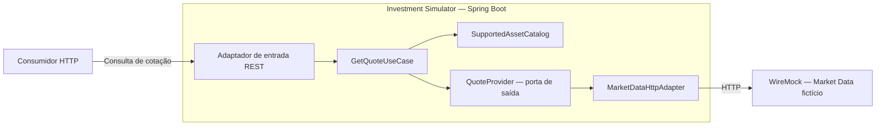

# Arquitetura inicial — Engineering Lab

**Projeto:** Engineering Lab — Investment Simulator  
**Incremento:** 01 — Consulta de cotações  
**Referência funcional:** [UC-001 — Consultar cotação de um ativo](../use-cases/uc-001-consultar-cotacao.md)  
**Status:** Implementada e verificada para o contrato aprovado da UC-001  
**Atualizado em:** 12/10/2026

## 1. Objetivo e limites

Definir a menor arquitetura útil para implementar a **UC-001**, preservando uma fronteira explícita entre o simulador de investimentos e um fornecedor fictício de *Market Data*. O objetivo prioritário é estudar e justificar decisões de engenharia, especialmente arquitetura hexagonal, DDD, integração HTTP, testes e tratamento de falhas.

O produto consulta, sob demanda, preços de referência **inteiramente sintéticos** para `PETR4`, `VALE3` e `ITUB4`, expressos em `BRL`. A resposta inclui o ativo, o preço, a moeda e o instante de referência. O preço é **informativo**: não representa oferta nem garante preço de execução.

Este incremento **não** inclui autenticação, frontend, carteira, compra e venda, histórico, banco de dados, cache de cotações, processamento assíncrono ou integração real com bolsa/corretora. Requisitos funcionais e critérios de aceite permanecem na UC-001; este documento registra suas consequências arquiteturais, sem substituí-la.

## 2. Diretrizes aprovadas

| Tema | Direção adotada |
|---|---|
| Linguagem e runtime | Java 25 (LTS) |
| Framework | Spring Boot 4.1.1, Spring MVC |
| Organização de repositório | Monorepo `engineering-lab`, com uma aplicação Spring Boot inicialmente |
| Arquitetura | Hexagonal (*Ports & Adapters*), sem multiplicar módulos ou interfaces sem necessidade |
| Organização de código | *Package by Feature*: começar pela capacidade `quote` |
| Modelagem | DDD pragmático: linguagem ubíqua, Value Objects e invariantes; sem agregados ou entidades artificiais |
| Dependências de framework | Domínio em Java puro; Spring permitido na aplicação e nos adaptadores |
| Integração HTTP de saída | `RestClient` |
| Fornecedor fictício | WireMock 3.13.2, em Docker localmente e como servidor isolado nos testes |
| Mapeamento | Manual inicialmente; sem MapStruct ou Lombok neste incremento |
| Testes | JUnit Jupiter e Mockito nas versões gerenciadas pelo Spring Boot; WireMock 3.13.2 e Spring Boot Test com RestTestClient |
| Cobertura e qualidade | JaCoCo 0.8.15; SonarQube em evolução posterior; sem meta obrigatória de 100% |
| Idioma | Código e contrato HTTP público em inglês; documentação funcional e de arquitetura em português |

Não existe decisão de criar microsserviços, múltiplos módulos Maven ou uma API intermediária dedicada à ACL.

As versões adotadas estão registradas no `pom.xml` e em `compose.yaml`. Sua compatibilidade foi verificada com Java 25 por `mvn verify`: 103 testes aprovados, empacotamento do JAR executável e geração dos relatórios JaCoCo. As evidências estão no [relatório de verificação da UC-001](../testing/uc-001-tests.md).

## 3. Contexto e responsabilidades



O diagrama mostra o **fluxo de execução**. A dependência de código tem direção diferente: o adaptador de saída implementa uma porta definida pela aplicação; a aplicação **não** importa classes do adaptador nem DTOs do fornecedor.

| Componente | Responsabilidade | Não deve fazer |
|---|---|---|
| Adaptador REST de entrada | Traduzir requisição/resposta HTTP e mapear erros públicos | Executar regras próprias de preço ou conhecer o contrato do fornecedor |
| `GetQuoteUseCase` | Orquestrar a consulta: validar suporte do ticker, chamar a porta e encaminhar o resultado | Conhecer `RestClient`, status HTTP do fornecedor ou WireMock |
| Domínio `quote` | Representar conceitos, invariantes e política de ativos suportados | Depender de Spring, HTTP ou infraestrutura |
| `QuoteProvider` | Expressar a necessidade interna de obter uma cotação | Expor DTO ou exceção específica de biblioteca HTTP |
| `MarketDataHttpAdapter` | Fazer a chamada HTTP, desserializar respostas, interpretar ausência/falhas e delegar a conversão ao mapper | Definir o catálogo aceito pelo produto |
| `MarketDataQuoteMapper` | Converter o DTO externo em `Quote`, conferir o ticker solicitado e traduzir falhas de construção dos Value Objects | Executar HTTP ou duplicar as invariantes de preço e moeda de `Quote` |
| WireMock | Reproduzir o contrato de uma dependência externa com preços e falhas sintéticos | Determinar regras internas do simulador |

A **ACL (Anti-Corruption Layer)** será exercida na fronteira do adaptador de saída: tradução de nomes, tipos, semântica de ausência e falhas. **Não** será criada uma camada ou aplicação ACL separada apenas para essa finalidade.

Na refatoração aprovada em 12/10/2026, a conversão foi extraída para `MarketDataQuoteMapper`, uma classe concreta no mesmo pacote `outbound.marketdata`, sem dependências de Spring ou HTTP. `QuoteConfiguration` registra o mapper via `@Bean` e o injeta no construtor do adaptador. Essa separação melhora a leitura e distingue transformação de dados dos detalhes de transporte; a ACL continua sendo uma responsabilidade dessa mesma fronteira. As invariantes de preço positivo e moeda BRL permanecem em `Quote`.

## 4. Domínio inicial e DDD

### 4.1. Modelo conceitual

```text
Quote  (Value Object)
├── Ticker  (Value Object)
│   └── code: String
├── Money   (Value Object)
│   ├── amount: BigDecimal
│   └── currency: java.util.Currency
└── referenceTime: Instant

SupportedAssetCatalog  (política de domínio)
└── supports(ticker): boolean
```

| Conceito | Regra / responsabilidade |
|---|---|
| `Ticker` | Representar um código de ativo não nulo e não vazio. Ser um ticker representável **não** equivale a ser suportado pelo produto. |
| `Money` | Representar montante e moeda não nulos. Pode conter valor negativo, zero ou positivo; não carrega a regra específica de preço de cotação. |
| `Quote` | Representar uma observação de preço em um instante; exigir ticker, valor monetário e horário de referência; exigir **preço > 0** e **moeda BRL** na UC-001. |
| `SupportedAssetCatalog` | Reconhecer exclusivamente `PETR4`, `VALE3` e `ITUB4`, independentemente do fornecedor. |

`Quote` é **Value Object**, não entidade: uma nova observação de preço não demanda a preservação da identidade de uma cotação anterior. Futuras operações simuladas poderão ter identidade própria sem transformar `Quote` em entidade.

O domínio não terá anotações Spring. Se necessário injetar `SupportedAssetCatalog` em um caso de uso, uma classe de configuração externa ao domínio o registrará via `@Bean`. Instâncias de `Ticker`, `Money` e `Quote` não serão beans gerenciados pelo container.

### 4.2. Decisões implementadas nos Value Objects

**`Money`:** o construtor normaliza `amount` com `BigDecimal.stripTrailingZeros()`. Assim, valores numericamente iguais, como `35.5` e `35.50`, têm a mesma representação normalizada e produzem igualdade e hash code consistentes no `record`, quando a moeda também é igual. A normalização preserva a precisão e não arredonda nem exige duas casas decimais. Montantes negativos, zero e positivos continuam permitidos em `Money`; a exigência de preço positivo pertence a `Quote`.

**`Ticker`:** a implementação atual exige código não nulo e não vazio e preserva o texto recebido. O catálogo reconhece os três códigos exatos aprovados: `PETR4`, `VALE3` e `ITUB4`. Políticas adicionais de formato, remoção de espaços ou conversão de caixa permanecem como questões de evolução; elas não bloqueiam o contrato atual da UC-001 e exigem decisão explícita antes de alterar o comportamento.

## 5. Portas, adaptadores e resultados internos

A porta de saída pertence à **aplicação** e trabalha com modelos internos. A assinatura abaixo foi aprovada em 12/10/2026 para a UC-001:

```java
public interface QuoteProvider {
    Optional<Quote> findByTicker(Ticker ticker);
}
```

Contrato semântico acordado:

| Situação | Resultado interno esperado |
|---|---|
| Cotação válida obtida | `Optional.of(Quote)` |
| Ausência **confirmada** de cotação | `Optional.empty()` |
| Indisponibilidade HTTP do fornecedor ou timeout | `QuoteProviderUnavailableException` |
| Resposta malformada ou dados de cotação inválidos | `InvalidQuoteDataException`; **não** `Optional.empty()` |

As duas exceções pertencem à aplicação, estendem `RuntimeException` e permitem preservar a causa técnica por um construtor com mensagem e causa. Elas não expõem tipos de transporte na assinatura da porta. As classes estão implementadas em `quote.application.exception`.

A escolha de `Optional<Quote>` para sucesso/ausência e exceções para falhas mantém o contrato pequeno. A alternativa de um tipo de resultado com variantes explícitas foi considerada, mas acrescentaria estrutura sem necessidade demonstrada neste incremento. Falhas nunca devem ser convertidas em ausência de cotação.

O adaptador deve preservar a causa técnica para diagnóstico, mas a aplicação não precisa diferenciar um HTTP 503 de um timeout **para tomar decisões na UC-001**. Logs e instrumentação HTTP podem fazer essa distinção sem exigir uma classe de exceção por causa técnica. Evitar registrar repetidamente a mesma falha em todas as camadas.

A verificação do catálogo ocorre **antes** de qualquer chamada externa. O contrato de `GetQuoteUseCase.execute(Ticker)` retorna `Optional<Quote>` e sinaliza ticker não suportado com `UnsupportedTickerException`, aprovada em 12/10/2026. Essa exceção pertence a `quote.application.exception`, estende `RuntimeException` e distingue o erro de suporte de outros argumentos inválidos. Para ticker suportado, o caso de uso devolve o resultado da porta e deixa suas falhas tipadas propagarem.

Cotações antigas obtidas com sucesso são válidas para exibição, desde que o horário acompanhe o preço. Se a consulta falhar, **não** apresentar cotação anterior como substituta.

## 6. Contrato HTTP público

**Contrato de sucesso aprovado em 12/10/2026:** consulta síncrona REST por ticker em `GET /v1/quotes/{ticker}`, com nomes de rota e campos em inglês.

A resposta `200 OK`, com `Content-Type: application/json`, contém:

| Campo | Representação JSON | Origem no modelo interno |
|---|---|---|
| `ticker` | String com o código do ativo | `quote.ticker().code()` |
| `referencePrice` | Número decimal | `quote.money().amount()` |
| `currency` | String com o código da moeda (`BRL`) | `quote.money().currency().getCurrencyCode()` |
| `referenceTime` | String ISO 8601 em UTC | `quote.referenceTime()` |

Exemplo sintético:

```json
{
  "ticker": "PETR4",
  "referencePrice": 35.50,
  "currency": "BRL",
  "referenceTime": "2026-10-10T14:30:00Z"
}
```

O preço é um número JSON, sem exigência de duas casas decimais na representação textual. O adaptador de entrada usa um DTO público e mapeamento manual dos tipos internos; os nomes do contrato do fornecedor não determinam os campos públicos.

| Cenário | HTTP público | Justificativa |
|---|---:|---|
| Cotação encontrada e válida | `200 OK` | Representação disponível, com ticker, preço, moeda e horário |
| Ticker não suportado | `400 Bad Request` | Parâmetro fora do catálogo aceito pelo produto |
| Ticker suportado sem cotação | `404 Not Found` | Recurso cotação indisponível, sem confundir com ticker inválido |
| Fornecedor indisponível / consulta expira | `503 Service Unavailable` | Dependência necessária não permitiu atender à consulta |
| Dados inválidos retornados pelo fornecedor | `500 Internal Server Error` | Falha interna ao produzir uma cotação válida; preservar diagnóstico da integração |

A opção por `500` no último cenário reflete a decisão para esta API de domínio; `502` seria pertinente se o papel contratual evoluísse para o de gateway/proxy. O status público **não** precisa reproduzir o status recebido do fornecedor.

Para erros, utilizar o suporte nativo do Spring a **[Problem Details — RFC 9457](https://www.rfc-editor.org/rfc/rfc9457.html)** (`ProblemDetail`, tratamento centralizado de exceções), evitando um envelope próprio de erros. A RFC 9457 substitui a RFC 7807. Definir mensagens públicas sem expor detalhes internos, URLs de infraestrutura ou stack traces. `ProblemDetail` padroniza a representação ao consumidor; **não substitui** métricas, logs e tracing. A definição de `code` e `message` para o fornecedor na seção 7 não fixa os campos do contrato público.

**Contrato de erros públicos aprovado em 12/10/2026:** respostas com `Content-Type: application/problem+json`, `type = about:blank`, `title` correspondente ao status HTTP, `status` coerente com a resposta e `instance` contendo o caminho da requisição. As extensões `code` e `message` seguem a tabela abaixo, com mensagens em inglês:

| HTTP | `code` | `message` |
|---|---|---|
| `400` | `UNSUPPORTED_TICKER` | `The requested ticker is not supported.` |
| `404` | `QUOTE_NOT_FOUND` | `No quote is available for the requested ticker.` |
| `503` | `QUOTE_PROVIDER_UNAVAILABLE` | `Unable to retrieve a quote at this time.` |
| `500` | `INVALID_QUOTE_DATA` | `Unable to return a valid quote.` |

Esses códigos identificam os cenários da UC-001. Em particular, `QUOTE_NOT_FOUND` significa ausência confirmada de cotação; um caminho HTTP inexistente não recebe esse código. `INVALID_QUOTE_DATA` identifica a falha tipada de dados da integração, não qualquer erro interno inesperado. As mensagens públicas são fixas; as causas técnicas são preservadas nas exceções internas para diagnóstico.

Na resposta HTTP observada, a serialização nativa omite `type` para esse problema genérico. Conforme a [seção 3.1.1 da RFC 9457](https://www.rfc-editor.org/rfc/rfc9457.html#section-3.1.1), a ausência desse membro significa implicitamente `about:blank`.

O adaptador de entrada utiliza `QuoteExceptionHandler`, com `@RestControllerAdvice` e métodos `@ExceptionHandler` que retornam `ProblemDetail`. O Spring preenche `instance` e serializa as extensões adicionadas por `setProperty(...)`. O advice da aplicação tem ordem `-1`, anterior ao advice de Problem Details configurado pelo Boot (ordem `0`), para permitir a personalização do `404` emitido pelo controller.

## 7. Contrato do fornecedor fictício

O WireMock simula um fornecedor independente. O contrato externo adotado no primeiro stub e no DTO de integração é `GET /market-data/quotes/{ticker}`. O stub de sucesso de `PETR4` foi implementado e consultado localmente em 12/10/2026.

Resposta de sucesso: `200 OK`, `Content-Type: application/json`, com os campos `symbol` (string), `lastPrice` (número decimal), `currency` (string) e `timestamp` (string ISO 8601 em UTC). Os quatro campos são necessários para produzir uma cotação válida. O DTO externo utiliza `String`, `BigDecimal`, `String` e `Instant`, respectivamente; o adaptador traduz esses dados para o modelo interno.

Exemplo com valores fictícios:

```json
{
  "symbol": "PETR4",
  "lastPrice": 35.50,
  "currency": "BRL",
  "timestamp": "2026-10-10T14:30:00Z"
}
```

Semântica acordada do fornecedor:

| Resposta / situação | Tradução no adaptador |
|---|---|
| `200` com cotação válida | DTO externo → `Quote` válido |
| `404` que confirme **ausência legítima de cotação** | `Optional.empty()` |
| `503` | Falha interna tipada de consulta |
| Timeout / conexão interrompida | Falha interna tipada de consulta |
| `200` com JSON malformado ou cotação inválida | Falha de dados/integração, sem apresentar preço |

### 7.1. Ausência confirmada: Problem Details

Definido em 12/10/2026: o `404` de cotação ausente seguirá a **[RFC 9457](https://www.rfc-editor.org/rfc/rfc9457.html)**, com `Content-Type: application/problem+json` e extensões `code` e `message`, conforme a preferência do responsável.

A RFC define `type`, `title`, `status`, `detail` e `instance`; `code` e `message` são extensões do nosso contrato, permitidas pela [seção 3.2](https://www.rfc-editor.org/rfc/rfc9457.html#section-3.2). O campo padrão para explicação textual é `detail`; neste erro, usaremos a extensão `message`, sem duplicar o texto em `detail`.

Exemplo para o tipo de problema aprovado em 12/10/2026:

```http
HTTP/1.1 404 Not Found
Content-Type: application/problem+json
```

```json
{
  "type": "https://market-data.example/problems/quote-not-found",
  "title": "Quote not found",
  "status": 404,
  "code": "QUOTE_NOT_FOUND",
  "message": "No quote is available for VALE3."
}
```

`type` é o identificador primário do problema; `code` é um identificador adicional estável. `message` é texto para pessoas e não determina a classificação da resposta. O status do corpo deve corresponder ao HTTP recebido. Extensões desconhecidas devem ser ignoradas.

O adaptador só produzirá `Optional.empty()` quando o `404` confirmar o problema contratado, com o `type` esperado e `code = QUOTE_NOT_FOUND`. Um `404` genérico, um tipo diferente ou corpo incompatível produzirá `InvalidQuoteDataException`, preservando a distinção entre cotação ausente e rota/stub incorreto.

**URI aprovada em 12/10/2026:** `https://market-data.example/problems/quote-not-found`. Ela identifica o tipo de problema do fornecedor fictício; não é a URL de consulta de cotações. A URI absoluta mantém a identidade independente da URL-base local do WireMock.

Usar fixtures sintéticas para os três ativos e stubs específicos para cenários de ausência, atualização, dados inválidos e falhas. O mock não deverá ser ajustado para esconder defeitos do cliente HTTP.

## 8. Organização física proposta

Apenas uma aplicação Spring Boot e um módulo Maven. A estrutura segue a capacidade de negócio `quote`, e não camadas globais separadas por toda a aplicação.

```text
engineering-lab/
├── investment-simulator/
│   ├── pom.xml
│   └── src/
│       ├── main/java/.../
│       │   ├── InvestmentSimulatorApplication.java
│       │   └── quote/
│       │       ├── domain/
│       │       │   ├── model/           # Quote, Ticker, Money
│       │       │   └── policy/          # SupportedAssetCatalog
│       │       ├── application/
│       │       │   ├── GetQuoteUseCase.java
│       │       │   └── port/            # QuoteProvider
│       │       └── infrastructure/
│       │           ├── inbound/rest/    # controller e DTOs públicos
│       │           ├── outbound/marketdata/ # RestClient, DTOs externos e ACL
│       │           └── config/          # composição dos beans
│       └── test/
├── wiremock/                      # stubs e dados simulados
├── docs/
│   ├── use-cases/
│   └── architecture/
│       ├── initial-architecture.md
│       └── adr/
├── compose.yaml
├── AGENTS.md
└── README.md
```

O caminho `...` indica o pacote-base Java a escolher no scaffolding, não um diretório literal. Não criar antecipadamente pacotes `wallet`, `trade`, `shared` ou módulos para capacidades ainda fora do escopo. *Package by Feature* não implica um Bounded Context por pacote.

## 9. Desenvolvimento local e estratégia de testes

- **Execução local:** aplicação Spring Boot + WireMock como processo separado, orquestrado quando útil via Docker Compose. Não haverá implementação Spring Boot do fornecedor na UC-001.
- **Testes de domínio:** JUnit Jupiter para invariantes de `Ticker`, `Money`, `Quote` e política do catálogo, incluindo limites e entradas inválidas.
- **Testes do caso de uso:** dublê da porta (Mockito quando agregar valor), verificando consulta apenas de ticker suportado, sucesso, ausência e propagação/tradução de falhas.
- **Testes do adaptador HTTP:** `MarketDataHttpAdapterTest`, com WireMock 3.13.2 e JUnit Jupiter, validando chamadas reais HTTP sem contexto Spring, contrato externo, tradução, timeout, erro de fornecedor e dados inválidos. A dependência `wiremock-standalone` é restrita ao escopo de testes.
- **Testes da API:** `QuoteApiTest`, com Spring Boot Test em porta aleatória e `RestTestClient` do Spring Framework 7, validando o fluxo completo, os status e `ProblemDetail`. A URL do fornecedor é substituída por `@DynamicPropertySource`; os timeouts da aplicação continuam vindo do YAML.
- **Cobertura e análise:** JaCoCo para medir cobertura; priorizar todos os critérios de aceite da UC-001 e cenários adversos em vez de perseguir 100% de linhas. SonarQube será acrescentado posteriormente.

Os sete critérios de aceite da UC-001 (`CA-001` a `CA-007`) devem ter evidência automatizada. Incluir também testes de diferenciação de `404` legítimo vs. incorreto, JSON malformado e comportamento sem fallback. Ainda não há banco de dados que justifique Testcontainers neste incremento.

Os testes HTTP criam seus próprios servidores WireMock em portas aleatórias, com stubs sintéticos isolados por teste, e encerram os servidores ao final. Eles não dependem dos containers locais nem alteram os mappings usados manualmente. A relação entre critérios, testes e falhas identificadas está em [Verificação da UC-001](../testing/uc-001-tests.md).

## 10. Resiliência e observabilidade: evolução controlada

Na UC-001, configurar conexão HTTP e timeouts explícitos. Valores iniciais aprovados em 12/10/2026:

| Configuração | Valor inicial |
|---|---|
| Timeout de conexão | 1 segundo |
| Timeout de leitura | 2 segundos |

Esses valores configuráveis limitam a espera pelo fornecedor local e facilitam cenários de falha simulada. Prazos maiores tolerariam mais demora, mas prolongariam a espera durante indisponibilidade. São limites operacionais por etapa, não uma garantia de tempo total de resposta nem metas de disponibilidade ou desempenho. O cliente HTTP escolhido deve respeitar essa distinção.

Não adicionar automaticamente retry, circuit breaker, bulkhead, failover, cache ou Kafka.

O diagnóstico de `503` recebido e de timeout deve permanecer distinguível na fronteira de saída. A instrumentação padrão do Spring/Micrometer poderá ser aproveitada quando habilitada. Experimentos posteriores deverão medir efeitos de mecanismos de resiliência, registrar ambiente e carga, e não extrapolar conclusões sem evidência.

## 11. Linguagem ubíqua e nomenclatura

| Negócio (documentação) | Código (inglês) |
|---|---|
| Cotação | `Quote` |
| Código do ativo | `Ticker` |
| Valor monetário | `Money` |
| Preço de referência | `referencePrice` (conceito; armazenado como `Money` em `Quote`) |
| Horário de referência | `referenceTime` |
| Catálogo de ativos suportados | `SupportedAssetCatalog` |
| Consultar cotação | `GetQuoteUseCase` |
| Porta de obtenção de cotação | `QuoteProvider` |
| Adaptador HTTP do fornecedor | `MarketDataHttpAdapter` |

Manter **código e testes em inglês**; documentação funcional, arquitetura e ADRs em **português**. O contrato JSON externo pertence ao fornecedor simulado; os nomes de rota e campos de sucesso do contrato público foram aprovados em inglês, conforme a seção 6.

## 12. Evolução e fechamento da UC-001

As decisões necessárias ao contrato atual estão consolidadas neste documento: versões da stack, igualdade de `Money`, rota e campos públicos, porta de saída, falhas internas, contrato do fornecedor e timeouts.

A política adicional de formato e normalização de `Ticker` permanece como questão de evolução. O comportamento atual está descrito na seção 4.2; uma mudança futura deve apresentar proposta e consequências ao responsável, antes da implementação.

**Fechamento do incremento:** a UC-001 está implementada e verificada para os critérios `CA-001` a `CA-007` e os cenários adversos definidos no [relatório dos testes](../testing/uc-001-tests.md). Mudanças futuras preservam o processo de decisões explícitas; decisões arquiteturais significativas terão ADR próprio, mantendo o histórico dos registros aceitos.

---

**Fontes de verdade:** a UC-001 governa o comportamento de negócio; este documento descreve a arquitetura inicial; os ADRs em `docs/architecture/adr/` preservarão o contexto e as consequências das decisões relevantes. Nenhuma implementação deve contrariar esses documentos sem revisão explícita.
